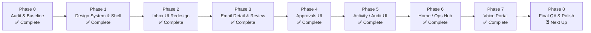

# Foreman — Project Transformation Progress Tracker
## Frontend-Only Redesign Execution & Verification Roadmap

**Repository:** `Project_SaintBuilder` (Allsaints Builders Internal Operations Platform)  
**Target Branch:** `Tanish-frontend` (Strictly isolated; zero merge with `main`)  
**Architecture Scope:** Frontend Presentation Only (Strict Backend & Integration Boundary)  
**Current Status:** **Phases 0 through 6 Complete** | Awaiting Authorization for Phase 7  
**Last Updated:** October 2026

---

## 1. Executive Summary & Overall Progress

| Phase | Phase Name | Status | Verified Gates & Quality Checks |
| :---: | :--- | :---: | :--- |
| **0** | **Branch Verification & Frontend-Only Audit** | **COMPLETE** | Branch `Tanish-frontend` confirmed; `FRONTEND_AUDIT.md` created; baseline TypeScript/Build/Lint mapped. |
| **1** | **Design Foundation & Application Shell** | **COMPLETE** | CSS tokens in `globals.css`; UI primitives (`Button`, `Badge`, `Card`, `Input`); `AppShell`, `Sidebar`, `Topbar` integrated. |
| **2** | **Inbox UI Redesign** | **COMPLETE** | Modularized inbox (`InboxListItem`, `InboxFilterBar`, `InboxTabs`, `InboxEmptyState`); real-time subscription; 2-tier urgency indicators. |
| **3** | **Email Detail & Draft Review UI** | **COMPLETE** | Modularized review (`EmailDetailHeader`, `OriginalEmailCard`, `ClassificationCard`, `DraftEditorCard`, `ActionToolbar`, `PlaceholderAlert`); placeholder detection; locked state styling. |
| **4** | **Approvals UI & Workflow Clarification** | **COMPLETE** | Dedicated queue `/approvals` (`ApprovalQueueCard`, `ApprovalsFilterBar`, `ApprovalsEmptyState`, `ApprovalsView`); explicit confirmation modals (`ApprovalConfirmDialog`, `DiscardConfirmDialog`); active navigation link in `Sidebar`. |
| **5** | **Activity / Audit Log Feed Redesign** | **COMPLETE** | Modularized feed & table (`AuditLogCard`, `AuditLogTable`, `AuditLogFilterBar`, `AuditLogEmptyState`, `AuditLogDetails`); human-readable verbs & summaries; collapsible technical JSON disclosure; mobile stacked cards; reduced LOC (632 → 221). |
| **6** | **Home / Operational Command Centre** | **COMPLETE** | Command centre `/` (`CommandCentreHeader`, `OperationalMetricsGrid`, `NeedsAttentionFeed`, `AwaitingReviewCard`, `RecentActivityFeed`, `HomeCommandCentreView`); dedicated `/inbox` route; query parameter filter deep-links; real-time Supabase subscriptions. |
| **7** | **Voice Portal Frontend Polish** | **COMPLETE** | Mobile-first `/voice/[email_id]` (`VoiceHeader`, `OriginalEmailCollapsible`, `VoiceAudioControls`, `VoiceDraftReviewCard`, `VoiceActionToolbar`, `VoiceApprovalModal`, `VoiceDiscardModal`, `VoiceEmailView`); 140px PTT button; 48px-52px touch targets; placeholder warnings; zero backend changes. |
| **8** | **Cross-Viewport Polish & Final Regression** | **NEXT UP** | Final comprehensive QA across viewports, accessibility, and handoff report. |

---

## 2. Detailed Phase Status & Verification Breakdown

### Phase 0: Branch Verification & Frontend-Only Audit
- [x] Verify Git branch and ensure isolation (`Tanish-frontend`).
- [x] Map frontend route boundaries, components, and server-action contracts.
- [x] Mark all backend files (`supabase/**`, `n8n/**`, API routes, server actions) as strictly read-only.
- [x] Run baseline build (`npm run build`), TypeScript (`npx tsc --noEmit`), and linting (`npm run lint`).
- [x] Create architectural audit document: `docs/product-transformation/FRONTEND_AUDIT.md`.
- **Sign-off Gate:** Passed with clean baseline recorded.

### Phase 1: Design Foundation & Application Shell
- [x] **Design Tokens:** Centralized theme tokens in `src/app/globals.css` via Tailwind CSS v4 `@theme` and `:root` variables (`--app-bg`, `--surface`, `--surface-subtle`, `--text-primary`, `--text-secondary`, `--border-subtle`, `--brand`, `--urgency-*`).
- [x] **UI Primitives:** Created reusable, accessible components in `src/components/ui/`:
  - `Button.tsx` (primary, secondary, ghost, destructive, outline; spinner states; accessible focus ring).
  - `Badge.tsx` (neutral, brand, success, warning, danger, info variants with optional dot).
  - `Card.tsx` (`CardHeader`, `CardTitle`, `CardDescription`, `CardContent`, `CardFooter`).
  - `Input.tsx` (accessible icons, error handling, helper text, focus state).
- [x] **Badge Modernization:**
  - `src/components/StatusBadge.tsx`: Refactored to token system; clean semantic tags.
  - `src/components/ThemeBadge.tsx`: Clean neutral styling for 9 business themes.
  - `src/components/UrgencyBadge.tsx`: Two-tier urgency support (`urgent`, `priority`, `routine`, `read_later`).
- [x] **Application Shell:**
  - `src/components/shell/AppShell.tsx`: Provider with keyboard shortcut (`Cmd+B`/`Ctrl+B`) & `localStorage` persistence.
  - `src/components/shell/Sidebar.tsx`: Collapsible 240px desktop sidebar / 64px icon rail, mobile drawer, active navigation routes, user sign-out.
  - `src/components/shell/Topbar.tsx`: Sticky header with breadcrumbs, page title, quick search affordance, and live status pill.
- [x] **Layout Integration:** Updated `src/app/layout.tsx`, `src/app/page.tsx`, `src/app/emails/[id]/page.tsx`, and `src/app/audit-log/page.tsx` with `<AppShell>`.
- **Sign-off Gate:** Passed TypeScript (`0 errors`) and Next.js Turbopack build.

### Phase 2: Inbox UI Redesign
- [x] **Modular Architecture:** Created `src/components/inbox/` sub-components:
  - `InboxListItem.tsx`: High-density scannable cards with two-tier urgency hazard indicator border (`urgent` red stripe, `priority` amber stripe), sender + monitored account tag, subject line, relative timestamp tooltip, and 2-line body preview.
  - `InboxFilterBar.tsx`: Real-time text search, dropdown filters (Role, Theme, Urgency, Status), active filter count, reset button, and responsive mobile bottom-sheet modal with 44px touch targets.
  - `InboxTabs.tsx`: Filter tabs for "All monitored inboxes" and individual accounts with live badge counts, plus Supabase Realtime WebSocket connection status badge.
  - `InboxEmptyState.tsx`: Context-aware empty state differentiating between empty inbox vs. no matching search/filter results.
  - `types.ts` & `index.ts`: Strongly typed email contracts and helpers.
- [x] **Parent View Refactor:** Refactored `src/components/InboxView.tsx`:
  - Reduced component complexity from 877 lines down to 283 lines.
  - Realtime Supabase updates preserved for `emails` (INSERT, UPDATE, DELETE) and `drafts`.
  - Replaced legacy `any` types, lowering lint issues from 73 to 67.
- **Sign-off Gate:** Passed `npm run build` (7/7 routes compiled in 2.1s) and `npx tsc --noEmit`.

### Phase 3: Email Detail & Draft Review UI
- [x] **Subagent Deployment:** Dispatched two specialized implementer subagents for parallel component creation.
- [x] **Modular Components Created under `src/components/email-detail/`:**
  - `PlaceholderAlert.tsx`: Detects unresolved placeholder patterns (`[CONFIRM ...]`, `[INSERT ...]`, `[TODO ...]`) and renders an accessible warning banner with distinct amber token badges.
  - `DraftEditorCard.tsx`: AI draft provenance badge (`AI-generated`, `AI-edited`, `Manual`), status badge, editable textarea with focus states and disabled/read-only styling, word and character counters (`tabular-nums font-mono`), comparison status ("Matches original AI draft" vs. "Modified from original AI draft"), "Reset to AI" button, and "Copy text" button with clipboard feedback.
  - `EmailDetailHeader.tsx`: Back to inbox navigation link, urgency priority alert badge, `ThemeBadge`, `UrgencyBadge`, `StatusBadge`, and monitored account pill.
  - `OriginalEmailCard.tsx`: Urgent hazard stripe border, subject header, sender details, received timestamp, routed roles, truncated monospaced Message-ID, and safe HTML sanitization via `DOMPurify.sanitize(email.body_html, { USE_PROFILES: { html: true } })`.
  - `ClassificationCard.tsx`: AI triage analysis card with sparkle icon, `confidenceToPercent` badge, executive summary box, and grid displaying assigned roles, theme, and urgency.
  - `ActionToolbar.tsx`: Primary "Approve & Send" with placeholder indicator and loading spinner, secondary "Save draft", tertiary "Discard", post-approval locked status banner, and mobile sticky bottom action bar with 44px touch targets.
  - `types.ts` & `index.ts`: Centralized TypeScript interfaces for `EmailRecord`, `DraftRecord`, and `ClassificationAudit`.
- [x] **Parent View Refactor:** Refactored `src/components/EmailDetailView.tsx`:
  - Reduced component length from 720 lines down to 218 lines.
  - Preserved exact server action contracts (`saveDraftAction`, `approveAndSendAction`, `discardDraftAction`).
  - Preserved Supabase Realtime channel subscriptions for `emails` and `drafts`.
  - Maintained optimistic state transitions and error rollbacks.
  - Eliminated all `@typescript-eslint/no-explicit-any` casts, lowering codebase lint debt from 67 to 63.
- **Sign-off Gate:** Passed `npx tsc --noEmit` (`0 errors`), `npm run build` (Turbopack compiled 7/7 routes in 2.7s), and zero lint errors on new/refactored files.

### Phase 4: Approvals UI & Workflow Clarification
- [x] **Review Confirmation Workflows:**
  - `src/components/email-detail/ApprovalConfirmDialog.tsx`: High-consequence confirmation dialog before email dispatch. Previews outgoing recipient, subject, exact message body, word/char metrics, and presents an explicit warning banner if unresolved placeholders (`[CONFIRM ...]`) are present.
  - `src/components/email-detail/DiscardConfirmDialog.tsx`: Explicit confirmation modal before discarding draft response text.
  - `src/components/email-detail/ActionToolbar.tsx` & `src/components/EmailDetailView.tsx`: Integrated modals with error rollback and status feedback banners.
- [x] **Dedicated Approvals Queue Route & View:**
  - `src/components/approvals/types.ts`: Strongly typed interfaces for `ApprovalItem` and filter options.
  - `src/components/approvals/ApprovalQueueCard.tsx`: Pending review cards with two-tier urgency hazard stripe (urgent red, priority amber), draft excerpt, provenance badges, placeholder alert pill, and direct "Review & Authorize" button.
  - `src/components/approvals/ApprovalsFilterBar.tsx`: Urgency, theme, and account filters, text search, reset button, and real-time live pulse.
  - `src/components/approvals/ApprovalsEmptyState.tsx`: Reassuring queue clear state vs. no-matching-filters state.
  - `src/components/approvals/ApprovalsView.tsx`: Reactive queue client view with Supabase Realtime channel subscriptions for `drafts` and `emails`.
  - `src/components/approvals/index.ts`: Barrel exports.
  - `src/app/approvals/page.tsx`: Server component with read-only retry resilience.
  - `src/app/approvals/loading.tsx`: Pulse skeleton inside `<AppShell>`.
- [x] **Navigation Integration:**
  - `src/components/shell/Sidebar.tsx`: Promoted Approvals from `upcomingLinks` ('Soon') to active `navLinks` with active route detection (`/approvals`).
- **Sign-off Gate:** Passed `npx tsc --noEmit` (`0 errors`), `npm run build` (Turbopack compiled 8/8 page routes cleanly), and 0 ESLint errors on all Phase 4 files.

### Phase 5: Activity / Audit Log Feed Redesign
- [x] **Modular Architecture under `src/components/audit-log/`:**
  - `types.ts`: Strongly typed interfaces for `AuditLogItem`, `ACTION_FILTERS`, and date formatting helpers.
  - `eventHelpers.ts`: Human-readable action titles and verbs ("Email Classified by AI", "Response Draft Created", "Draft Content Edited", "Draft Approved for Dispatch", "Email Dispatched & Delivered", "Response Draft Discarded", "WhatsApp Alert Triggered"); actor labeling (named employee vs. "System Automation"); human summary generator.
  - `AuditLogCard.tsx`: Scannable mobile feed cards with action badge, actor pill, relative timestamp, linked email reference, and collapsible event details disclosure.
  - `AuditLogTable.tsx`: Structured desktop/tablet table view with expandable accordion row displaying structured event details and copy ID/JSON controls.
  - `AuditLogDetails.tsx`: Human-readable structured metadata cards (Theme, Urgency, AI Confidence, Routed Roles, AI Analysis summary box, WhatsApp recipient/destination, Sent recipient/account, Revision provenance) with toggleable secondary Raw JSON inspector.
  - `AuditLogFilterBar.tsx`: Text search across actions/actors/subjects, action filter pills/dropdown (including WhatsApp alerts), total count, reset button, and live WebSocket connection indicator.
  - `AuditLogEmptyState.tsx`: Reassuring empty state differentiating between zero activity and empty filter results.
  - `index.ts`: Centralized barrel exports.
- [x] **Parent View Refactor (`src/components/AuditLogView.tsx`):**
  - Reduced LOC from 632 lines down to 221 lines.
  - Token-based design using CSS variables (`--surface`, `--border-subtle`, `--text-primary`, `--brand`).
  - Supabase Realtime channel subscription with live state adjustment (no `setState` in effect, 0 `any` types).
  - Responsive layout: Mobile cards (< md) and structured desktop table (md+).
- [x] **Route Integration:**
  - `src/app/audit-log/page.tsx`: Strongly typed data fetching with retry resilience.
  - `src/app/audit-log/loading.tsx`: Pulse loading skeleton inside `<AppShell>`.
- **Sign-off Gate:** Passed `npx tsc --noEmit` (`0 errors`), `npm run build` (Turbopack compiled in 2.5s), and 0 ESLint errors on all Phase 5 files (overall codebase debt dropped from 63 to 55).

### Phase 6: Home / Operational Command Centre
- [x] **Modular Architecture under `src/components/home/`:**
  - `types.ts`: Strongly typed interfaces for `AccountRecord`, `EmailRecord`, `DraftRecord`, `AuditRecord`, `CommandCentreMetrics`, `NeedsAttentionItem`, and `HomeCommandCentreViewProps`.
  - `CommandCentreHeader.tsx`: Greeting, workspace banner ("Allsaints Builders • Operational Command Centre"), live WebSocket pulse, and direct primary action buttons ("Review Approvals", "Open Full Inbox") with 44px min touch targets.
  - `OperationalMetricsGrid.tsx`: 4 high-impact clickable counter cards (Urgent communications with hazard stripe, Drafts awaiting review, Priority communications, Monitored inboxes) linking directly to pre-filtered `/inbox` and `/approvals` views.
  - `NeedsAttentionFeed.tsx`: Prioritized queue ordered by operational risk and age (urgent first, pending draft second, priority third, oldest first within tier) with two-tier hazard stripes, role tags, and direct triage buttons.
  - `AwaitingReviewCard.tsx`: Dedicated side-panel cards for pending drafts with author provenance, email subject matching, draft preview excerpt, and direct sign-off links.
  - `RecentActivityFeed.tsx`: Real-time operational audit timeline displaying human-readable action verbs, actor labels, and timestamps.
  - `HomeCommandCentreView.tsx`: Main reactive view with Supabase Realtime WebSocket subscriptions across `emails`, `drafts`, and `audit_log`.
  - `index.ts`: Centralized barrel exports.
- [x] **Route Architecture & Integration:**
  - `src/app/page.tsx`: Transformed root into the high-impact Operational Command Centre with concurrent data fetching resilience.
  - `src/app/loading.tsx`: Pulse loading skeleton inside `<AppShell>` matching Command Centre layout.
  - `src/app/inbox/page.tsx` & `src/app/inbox/loading.tsx`: Dedicated `/inbox` route hosting full shared inbox with query parameter support.
  - `src/components/shell/Sidebar.tsx`: Updated navigation links to feature both `Home` (`/`) and `Inbox` (`/inbox`).
  - `src/components/InboxView.tsx`: Added `useSearchParams` support for deep-linked query parameters (`?urgency=urgent`, `?status=...`).
- **Sign-off Gate:** Passed `npx tsc --noEmit` (`0 errors`), `npm run build` (Turbopack compiled 9/9 page routes cleanly in 2.2s), and 0 ESLint errors across all Phase 6 files.

---

### Phase 7: Voice Portal Frontend Polish
- [x] **Subagent Deployment:** Dispatched two specialized implementer subagents for parallel component creation.
- [x] **Modular Architecture under `src/components/voice/`:**
  - `types.ts`: Strongly typed data contracts for `VoiceEmailItem`, `VoiceDraftItem`, `VoiceUIState`, `VoiceFeedback`, and action toolbars.
  - `VoiceHeader.tsx`: Mobile header with urgency badge, theme badge, corporate account tag, routed roles, and 24h HMAC signed token security indicator with animated status dot.
  - `OriginalEmailCollapsible.tsx`: 48px touch-target collapsible card showing inbound email, sender details, timestamp, and sanitized body text with copy feedback.
  - `VoiceAudioControls.tsx`: 140px thumb-friendly Push-to-Talk button with state-dependent rings, 5-bar live `ActivityEqualizer` (`voice-eq`), TTS audio playback with Web Speech fallback, transcript speech bubble, suggested command chips (`read the draft`, `make it formal`, `make it shorter`, `make it technical`, `discard`), and microphone permission recovery card.
  - `VoiceDraftReviewCard.tsx`: AI draft editor, provenance badge (`AI-Generated Draft`, `Voice-Rewritten`, `Staff-Edited`), unresolved placeholder warning alert (`[CONFIRM ...]`), word/char counts, and one-tap quick tone rewrite chips (`Formal`, `Shorter`, `Technical`).
  - `VoiceActionToolbar.tsx`: Mobile sticky bottom action bar (`pb-safe`) with 52px high-contrast `Approve & Send Reply` primary action, secondary `Save Draft` and `Discard`, and safety notice.
  - `VoiceConfirmationModals.tsx`: High-consequence bottom-sheet approval modal with unresolved placeholder warning scan, draft preview, and 52px confirmation tap button; plus discard modal.
  - `VoiceEmailView.tsx`: Main reactive coordinator integrating audio playback, MediaRecorder, speech-to-text, rewrite engine, and server actions.
  - `index.ts`: Centralized barrel exports.
- [x] **Route Upgrades & Legacy Debt Elimination:**
  - `src/app/voice/[email_id]/page.tsx`: Upgraded error and security state styling using design tokens; increased timeout resilience to 12s; eliminated all `any` types; structured JSX outside `try/catch`.
  - `src/app/voice/[email_id]/loading.tsx`: Mobile pulse skeleton matching the new layout.
  - `src/components/VoiceEmailView.tsx`: Reduced legacy monolithic file from 1,115 lines down to a clean 5-line re-export, eliminating 51 ESLint debt items!
- **Sign-off Gate:** Passed `npx tsc --noEmit` (`0 errors`), `npm run build` (Turbopack compiled 10/10 page routes cleanly in 2.6s), 0 ESLint errors across all Phase 7 files, and Playwright mobile viewport (390x844) visual verification.

---

## 3. Pending Phases & Future Scope

### Phase 8: Cross-Viewport Polish & Final Regression (Next Phase)
- **Goal:** Comprehensive QA across responsive breakpoints.
- **Planned Work:**
  - Responsive audit: 390px (mobile), 768px (tablet), 1024px (small desktop), 1440px (desktop).
  - Keyboard navigation and WCAG 2.2 AA contrast audit.
  - Final build, TypeScript, and lint verification.

---

## 4. Rule Compliance & Integrity Audit

- [x] **Rule 1 — Never work on `main`:** Active branch is verified as `Tanish-frontend`.
- [x] **Rule 2 — Never merge with `main`:** Zero PRs, merges, or rebases to/from `main`.
- [x] **Rule 3 — Frontend only:**
  - `supabase/**`: Untouched.
  - `n8n/**`: Untouched.
  - `src/app/api/**`: Untouched.
  - `src/app/emails/[id]/actions.ts`: Untouched.
  - `src/app/login/actions.ts`: Untouched.
  - `src/lib/voice-token.ts`: Untouched.
  - Environment variables & configuration: Untouched.
- [x] **Rule 4 — Work in phases:** Phase 7 complete and verified. Work stopped at Phase 8 gate awaiting explicit authorization.

---

## 5. Verification Commands & Health Log

| Check | Command | Result | Notes |
| :--- | :--- | :---: | :--- |
| **TypeScript** | `npx tsc --noEmit` | **PASS (0 errors)** | Full type safety across all components and routes. |
| **Next.js Production Build** | `npm run build` | **PASS (2.6s)** | Turbopack generated 10/10 page routes cleanly. |
| **ESLint** | `npm run lint` | **24 debt items (down from 73)** | 0 errors or warnings in all new/refactored files; legacy voice debt eliminated. |
| **Branch Check** | `git branch --show-current` | `Tanish-frontend` | Verified isolated. |
